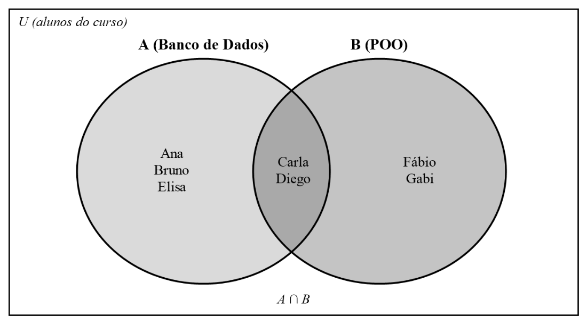
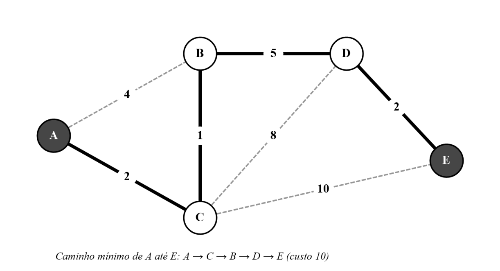

# 🔢 Matemática Discreta Aplicada à Computação

Trabalho da disciplina de **Matemática Discreta** na **Fatec Taquaritinga**. Ele apresenta os conceitos da ementa (**conjuntos, indução, análise combinatória, lógica formal, relações, funções, grafos e árvores**) e aplica cada um a uma **situação-problema do curso de ADS**.

| Arquivo | Descrição |
|---|---|
| 📄 [`Trabalho_Matematica_Discreta.pdf`](Trabalho_Matematica_Discreta.pdf) | Trabalho completo nas normas ABNT (22 páginas) |
| 📝 [`Trabalho_Matematica_Discreta.docx`](Trabalho_Matematica_Discreta.docx) | Versão editável |

---

## 🗺️ Conceito → aplicação

| Tópico da ementa | Situação-problema | Área do curso |
|---|---|---|
| Teoria dos conjuntos | Alunos matriculados em duas disciplinas | Banco de dados |
| Lógica formal | Simplificação de uma condição de acesso | Programação |
| Análise combinatória | Quantidade de senhas e de grupos de trabalho | Segurança da informação |
| Indução matemática | Número de comparações de um laço aninhado | Algoritmos |
| Relações e funções | Turmas, chaves primárias e função hash | Banco de dados e estruturas de dados |
| Grafos e árvores | Menor caminho entre pontos de uma rede | Redes e algoritmos |

---

## ✅ Situações-problema resolvidas

### 1. Conjuntos em consultas SQL



- A = {Ana, Bruno, Carla, Diego, Elisa} (Banco de Dados)
- B = {Carla, Diego, Fábio, Gabi} (POO)

| Operação | Resultado | Em SQL |
|---|---|---|
| A ∪ B | {Ana, Bruno, Carla, Diego, Elisa, Fábio, Gabi} | `UNION` |
| A ∩ B | {Carla, Diego} | `INTERSECT` |
| A − B | {Ana, Bruno, Elisa} | `EXCEPT` |

Inclusão e exclusão: |A ∪ B| = 5 + 4 − 2 = **7**

### 2. Lei de De Morgan na programação

¬(p ∧ q) ≡ ¬p ∨ ¬q, comprovado pela tabela-verdade:

| p | q | ¬(p ∧ q) | ¬p ∨ ¬q |
|:-:|:-:|:-:|:-:|
| V | V | F | F |
| V | F | V | V |
| F | V | V | V |
| F | F | V | V |

```js
!(autenticado && admin)   ≡   !autenticado || !admin
```

### 3. Análise combinatória

| Situação | Cálculo | Resultado |
|---|---|---:|
| Senha de 4 dígitos | 10⁴ | **10.000** |
| Senha de 6 caracteres (62 símbolos) | 62⁶ | **56.800.235.584** |
| Grupos de 4 numa turma de 40 | C(40, 4) | **91.390** |

### 4. Prova por indução de um laço aninhado

**Afirmação:** 1 + 2 + … + n = n(n + 1)/2

- **Base:** para n = 1, 1 = 1·2/2 ✔
- **Passo:** se vale para k, então k(k + 1)/2 + (k + 1) = **(k + 1)(k + 2)/2** ✔

Para n = 1.000, são **500.500** execuções, um crescimento **quadrático**.

### 5. Relações e funções

- **"Está na mesma turma que"** é reflexiva, simétrica e transitiva, portanto uma **relação de equivalência**: cada turma é uma classe.
- **Matrícula → aluno** é uma função **injetora**, a ideia da **chave primária**.
- **h(x) = x mod 7** não é injetora: h(15) = h(22) = 1, uma **colisão** na tabela hash.

### 6. Caminho mínimo com Dijkstra



| Passo | Visitado | B | C | D | E |
|:-:|---|:-:|:-:|:-:|:-:|
| 1 | A (0) | 4 | 2 | ∞ | ∞ |
| 2 | C (2) | 3 | 2 | 10 | 12 |
| 3 | B (3) | 3 | 2 | 8 | 12 |
| 4 | D (8) | 3 | 2 | 8 | 10 |
| 5 | E (10) | 3 | 2 | 8 | **10** |

O menor caminho é **A → C → B → D → E = 10** (2 + 1 + 5 + 2). O caminho direto A → C → E custaria 12.

---

## 💡 Conclusão

A Matemática Discreta é a **base teórica** de Banco de Dados, Estrutura de Dados, Programação e Redes. Seus conceitos aparecem diretamente no dia a dia do desenvolvimento de sistemas.

## 📚 Referências

- GARCIA LÓPEZ, J.; TOSCANI, L. V.; MENEZES, P. B. **Aprendendo matemática discreta com exercícios**. Bookman, 2009.
- GERSTING, J. L. **Fundamentos matemáticos para a ciência da computação**. 5. ed. LTC, 2004.
- LIPSCHUTZ, S.; LIPSON, M. **Matemática discreta**. Bookman, 2004.
- SCHEINERMAN, E. R. **Matemática discreta: uma introdução**. Cengage Learning, 2008.
- SULLIVAN, M.; MIZRAHI, A. **Matemática finita: uma abordagem aplicada**. LTC, 2006.

---

## 🎓 Informações acadêmicas

| | |
|---|---|
| **Instituição** | Fatec Taquaritinga |
| **Curso** | Análise e Desenvolvimento de Sistemas — 1º semestre |
| **Disciplina** | Matemática Discreta |
| **Ano** | 2026 |

## 👤 Autor

**Juan Gabriel Pereira Augusto**
GitHub: [@JuanGabrielPereiraAugusto](https://github.com/JuanGabrielPereiraAugusto)
